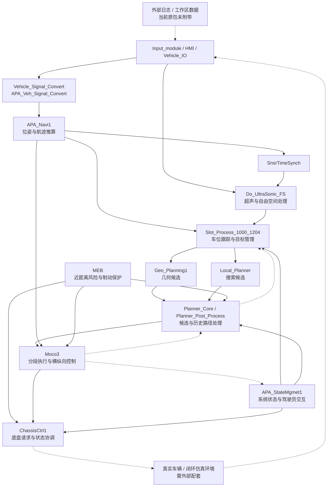

# APA Simulink 架构与工程完整性分析

分析日期：2026-11-06。

分析对象：`APA-Simulink.rar` 中的 `APA/F515_APA_Seres_V3p24_offline.slx` 及其配套 MATLAB 文件。当前 C/Pangu/MBD 代码仅用于对照，不反过来当作原模型已经实现某项功能的证据。

本轮直接解析 SLX 内的层级、连线、Stateflow、配置集，并阅读主要内嵌脚本、初始化文件及已有代码生成记录；没有启动 MATLAB，没有执行本轮模型更新、仿真或整模生成。

## 1. 先回答：它是不是一个完备的项目？

**从主要功能架构看，这是一个覆盖面较完整的 APA 系统模型，而不是只有某个泊车规划函数的演示。它已有输入处理、定位与同步、车位处理、状态管理、两路规划、路径后处理、运动控制、安全保护和底盘交互。**

**但从当前交付材料看，它还不能被认定为“拿到文件即可独立复现、完整闭环运行，并已经验证完善”的项目。更准确的定位是：保留了较完整系统骨架和大量实现的离线模型基线，运行数据、有效配置和验证材料尚未闭合。**

这里需要分开判断五件事：

| 判断维度 | 当前结论 | 主要依据 |
|:---|:---|:---|
| APA 主功能链是否存在 | 存在，且不只包含规划 | 已核对车位、状态、规划、后处理、控制与底盘的模型层级和关键连接 |
| 原模型是否仅为几个空壳子系统 | 不是 | 有大量具体计算、状态转移、历史缓存及外部 MATLAB 函数实现 |
| 当前压缩包是否具备独立复现条件 | 尚不具备 | 离线工作区数据未附带，历史整模生成也因变量缺失而失败 |
| 保存版本是否启用了原模型的全部功能 | 没有 | LAEB、LRAS 等存在显式停用和零值总线替代 |
| 算法、闭环性能及安全性是否已充分验证 | 不能确认 | 缺少完整模型复现与闭环测试证据，静态结构不能证明性能或安全性 |

因此，不能简单说“这个 APA 什么都没有做完”，也不能因为子系统很多就说“这是已经完善的完整产品”。**当前最明确的缺口首先是工程复现条件和功能范围定义，算法完善程度还需要另外验证。**

## 2. 材料之间的关系与本轮证据范围

| 材料 | 本轮如何使用 | 不应混淆的边界 |
|:---|:---|:---|
| `APA-Simulink.rar` | 判断原模型层级、依赖和功能组织的首要来源 | 不是当前 CARLA/Pangu 运行工程 |
| `apa_matlab_codegen_20261018.zip` | 阅读原 MATLAB 的 UTF-8 副本、模型脚本与生成记录 | `generated/` 是参考生成单元，不是完整 APA 整模产物 |
| `APA_ANALYSIS.md` | 辅助定位原系统功能与函数 | 部分统计及概括需按实际文件重新核对 |
| `apa.zip` | 对照当前 C 算法、MBD 封装和运行调度 | 不能据此认定原模型逻辑已全部迁移 |
| `apa_docs.zip` | 辅助理解当前改写方案 | 只有 5 篇 Markdown，部分图、附录和实例未附带 |

原始资料核对结果：

- 一个顶层 SLX，另有 189 个独立 `.m` 文件：根目录 1 个、DataDictionary 14 个、PlanningSubFcn 98 个、GeoPlanningSubFcn 58 个、SPTSubFcn 6 个、USSubFcn 12 个。
- SLX 内解析到 28,958 个 Block、859 个 System（含根系统）和 258 个 Stateflow Chart；顶层有 36 个 SubSystem。
- 这些数量包含旧版本、注释停用块、接口块、显示块和 Stateflow 内部生成块，不能直接视为有效算法模块数量。
- 对照归档另有 199 段模型内嵌脚本的阅读副本，不应与独立 `.m` 文件数相加后当作独立功能数量。
- 两份归档中的顶层 SLX 内容一致，模型 SHA-256 为 `2d6788b3ee229ce24e337728dfbe7a971baa580b9f4cfcd20eb845e777ffbede`。

## 3. 整体架构：不是一条单向流水线

原系统的主要关系是：**外部信号形成车辆与环境状态，车位模块管理可用车位；几何与搜索分别产生候选；后处理结合历史选择执行路径；控制执行过程中持续反馈状态，并可能触发重规划或停车。**

下图按真实关键连接概括，省略 BusSelector、From/Goto、延时和日志支路。外部车辆/仿真环境使用虚线表示，不代表当前压缩包已经包含它。

### 3.1 输入与车辆信号：原模型带有明显的离线回放外壳

主要位置：`Input_module`、`HMI`、`Vehicle_IO`、`Vehicle_Signal_Convert`、`APA_Veh_Signal_Convert`。

`Input_module` 汇集超声、视觉车位、定位等信号，内部可以看到 `From_Vis_Slot`、`SensorSig`、`GPS`、`VSLAM` 及不同车型的超声输入分支。`Vehicle_IO` 和 `HMI` 提供底盘及用户操作相关输入，两个信号转换模块进一步形成算法使用的总线。

这些模块不是“接上一个车速即可运行”的简单接口。当前模型用大量 `FromWorkspace` 读取记录信号，包含感知、底盘、HMI，也包含历史状态和用于对照的记录量。

**原模型接收视觉车位、自由空间等感知结果，不等于已经在该包内包含原始摄像头图像到车位检测的完整视觉算法。**后续确定 GAASD 范围时，应明确哪些感知结果由外部提供，哪些融合与跟踪功能需要保留。

### 3.2 定位与时间同步：把不同来源的数据放到一致时空基准下

主要位置：`APA_Navi1`、`SnsrTimeSynch`。

`APA_Navi1` 接收车辆转换信号、状态管理、LRAS 和控制反馈，输出 `Navi_Info` 等数据。内部存在航迹推算、轮速里程、运动方向、航向处理和滤波逻辑；其职责并不只是转发一个外部位置。

`SnsrTimeSynch` 接收传感器、导航、车辆及 APA 状态，输出同步信息，再送往车位和超声/自由空间处理。

这部分是后续迁移的一个明确边界：若使用 CARLA 真值位姿替代原导航，需要明确说明这是仿真适配；不能同时把它当作原定位链已经完成等价迁移。

### 3.3 环境与车位处理：原系统不仅规划一个人工给定目标

主要位置：`Do_UltraSonic_FS`、`Slot_Process_1000_1204`。

`Do_UltraSonic_FS` 输出超声处理结果、自车历史轨迹 `Ego_Trajectory` 和融合边界 `Fusion_Boundary`。其内嵌脚本 `Subsystem2/Vis_FS_Cache` 实际调用外部 `processFSPoints` 和 `ultrasonicCorrection`，不是只有名称的空模块。

`Slot_Process_1000_1204` 同时接收感知、位姿、同步、系统状态、规划反馈、控制反馈、历史轨迹及融合边界。内部有效分支包含车位四角跟踪、缓存、角点调整、目标点重算和视觉目标处理。

它承担的是“车位随观测更新并供规划使用”的持续管理，而不是每次只把四个角点透传给规划器。当前保存模型同时包含多个新旧版本，例如 `Slot_4Points_Tracking1` 未注释，`Slot_4Points_Tracking2` 已注释，不能把两个版本都当作同时执行。

### 3.4 系统决策：有完整生命周期，不只是一个 enable

主要位置：`APA_StateMgmet1/APA_Main_STATE/APA_Main_STATE`，对应 Stateflow Chart ID `17000`。

该状态机能够看到待命、驾驶员搜索、泊出等待、底盘等待、执行、暂停、路径等待、重规划、紧急制动、故障、接管和完成等状态。代表名称包括：

`Off`、`Standby_Inner`、`Driver_Search`、`Wait2PrkOut`、`ChassisWait`、`Processing`、`Pause`、`WaitOnPath`、`RePlan`、`EmergencyBrk`、`OverRide`、`FAIL`、`Finish`。

其输入包含规划、控制、MEB、车位、底盘和诊断反馈；内部还有 `StrTakeOver`、功能监控和 HMI 处理等分支。说明系统状态会影响规划和执行，而执行结果又会影响状态迁移。

需要特别区分三类状态：

| 状态层次 | 职责 | 不能混用的原因 |
|:---|:---|:---|
| 整车 APA 主状态 | 用户功能生命周期、暂停、退出、故障和接管 | 不是简单的搜索/泊车二值状态 |
| 规划主状态与车位状态 | 当前是否搜索、是否泊车、哪个车位待规划或需重规划 | `EnumParkingSysMainState` 只有 INVALID / SEARCHING / PARKING，不能替代整车 APA 状态 |
| MoCo 执行状态 | 当前路径段、转向准备、行驶、停稳、换挡、结束 | 需要连续车辆反馈和历史计数，不能由“路径有效”直接替代 |

### 3.5 规划层：几何和搜索是两路候选，不是先后两个必经阶段

几何入口是 `Geo_Planning1/Geo_Planning_Seres`，其内嵌脚本约 1,065 行；搜索入口是 `Local_Planner/path_planning_alg`，内嵌脚本约 4,273 行。两个入口都真实存在于 SLX 中。

几何侧按车位与起始条件调用垂直、平行、车头入库等函数，使用圆弧、直线、危险点分析、碰撞区间检查及路径离散化。

搜索侧包含 Hybrid A* 的调度、节点扩展、启发代价和解析连接。不能只看外部 `ClassHybridAStar.m` 的类定义，就认为搜索实现很少；大量实际计算在模型内嵌 `path_planning_alg` 中。

关键架构事实是：**几何和搜索的输出都送入 `Planner_Core`。原模型不是强制“几何成功以后再跑搜索”，也不能直接概括成“几何失败才有搜索”。**具体候选的触发和更新条件需要结合各入口及后处理状态看。

这与当前运行 C 中部分分支采用“主几何失败后再按条件回退搜索”的调度不同；即使底层公式相似，候选产生时机也可能改变最终路径。

### 3.6 路径后处理：它是规划到控制之间的重要业务层

主要位置：`Planner_Core/Planner_Post_Process`，Stateflow Chart ID `52669`，内嵌脚本约 2,802 行。

已确认它显式保存三类跨调用路径容器：`search_path_list`、`geo_path_list`、`mem_path_list`，并分别处理更新标记和历史路径。

这部分不只是一个取最短值的选择器，还涉及输入路径预处理、车位关联、定位复位、候选有效性及质量比较、历史路径更新，以及满足条件时的路径补点、跳段和重规划处理。输出包含实际执行路径及更新标识 `Path_Update_Idx`。

因此，未来画布中若只有“规划器 → 控制器”，而没有明确承接这些职责的位置，就不能声称已覆盖原系统的完整路径管理。

### 3.7 控制层：状态执行、路径参考和横纵协调相互关联

主要位置：`Moco3/APA_Ctrl_Module`。原模型不是当前 C 中四个 `V2` 函数的同名平铺，而是 Stateflow、Simulink 运算块和多个子系统共同组成控制链。

| 实际位置或模块 | 主要职责 |
|:---|:---|
| `APA_Ctrl_Chart` | 路径初始化、行驶方向、活动段、转向准备、行驶、停稳、换挡、路径等待及故障处理 |
| `APA_Ctrl_Chart` 内部 `PathPoint_Transfer` 等函数 | 参考点转换、路径点选择、距离和段进度计算 |
| `LongiCtrl_Pre1/Subsystem/LongiCtrl_mod1` | 根据泊车类型、剩余距离、段状态及障碍等条件组织纵向目标 |
| `LatCtrl_F1/StrAng_Ctrl` | 横向与航向误差相关转向计算 |
| `LatCtrl_F1/StrAng Limit1`、`StrLimit`、`StrSpdUp1` | 转角与转向速度等约束、转向过程处理 |
| `LatCtrl_F1/DecelerateAndReplan1` | 横向/目标位姿相关的减速与重规划协调 |
| `StandStill_Sts`、`GearChck` 及外层档位模块 | 停稳判断、档位检查和换向相关配合 |
| `CollisionBasedAx`、`ObjNotice` | 风险相关纵向处理及特定障碍提示 |

`APA_Ctrl_Chart` 中可以看到 `APA_Process`、`NormalStep`、`SteerReady`、`Move`、`Pause`、`ChgGear`、`APA_Finish`、`FailCtrl` 等状态，也保留 LRAS 相关子状态。存在这些代码不意味着所有功能分支在当前输入和配置下可达。

对 APA 尤其重要的是：**前进/倒车改变需要与路径段、停稳、档位反馈和控制历史协调，不能照搬 ACC 的单向纵向输出逻辑。**

### 3.8 安全保护与底盘：有相关实现，但不能把全部功能都算作已启用

`MEB` 有传感器处理、碰撞检测、轨迹相关检测及轮挡处理等内容，并向状态、规划、控制和底盘链提供反馈。`PDC`、`StateCal`、`Diagnose`、`DTC` 分别提供近距离提示、状态/阻碍与坡道相关判断、诊断及故障相关处理。

`ChassisCtrl1` 接收车辆状态、APA 主状态、MoCo、MEB 和诊断信息，内部包含 `APA_ESC`、`EPS` 等底盘交互模块。旧 `APA_ChassisCtrl` 已注释停用，不能将其再算作第二条有效底盘主链。

当前还有明确的功能裁剪：

- 顶层 `APA_LAEB`、`LRAS_Module`、`LRAS_State`、`SVM_Diagnose` 为注释停用状态。
- 顶层 `Subsystem4` 无外部输入，用零常量及总线拼接输出 `LRAS_Info`、`LAEB_Feature_Output`，作为相关接口的替代输入。
- `Moco3` 的 `Sub_AEBMode` 输入在当前根图中接零常量。

这可以是一个特定离线配置的合理裁剪，并不自动意味着核心 APA 无法泊车；但它明确说明：**当前保存配置不能代表完整启用的 LAEB、LRAS 或 AEB 模式能力，更不能直接作为全功能安全性证明。**

## 4. 调度与历史状态：迁移时比子系统名称更重要

### 4.1 模型是多速率事件调度，不是所有模块每帧都执行

根调度器是 `dSpace_Comms_OS`，Stateflow Chart ID `14937`。当前保存的活动配置集是 `Configuration1`，固定步长 `0.005 s`，目标文件 `grt.tlc`；模型也保留了 `rti1401.tlc` 的 dSPACE 配置，但它不是当前活动配置。

下表根据调度器的计数条件整理。周期一列以“根调度器每 5 ms 执行一次”为前提，是静态推算；启动相位及实际执行频率仍需在模型运行中记录确认。

| 计数条件 | 该分组发出的代表事件 | 推算周期 | 需要注意 |
|:---|:---|:---|:---|
| `j` 每 4 次触发 | 诊断、状态管理、PDC、导航、同步、超声/自由空间等 | 20 ms | `do_ultrasonic_fs_100ms` 虽名为 100 ms，却与该分组同发出 |
| `i` 每 10 次触发 | 车位处理、几何规划、规划后处理 | 50 ms | `SlotProcess_20ms` 和 `Planner_core_20ms` 的名称与该条件不一致 |
| `n` 每 160 次触发 | 搜索规划 | 800 ms | 搜索与控制不是同一速率 |
| `k` 每 4 次触发 | LRAS 事件、MEB、MoCo、底盘输出 | 20 ms | 发出某个事件不等于已停用的功能实际执行 |
| `o` 每 10 次触发 | IVI 输出 | 50 ms | 显示与控制的频率不同 |

根图中已核对这些触发信号经 From/Goto 连接到 `Slot_Process_1000_1204`、`Geo_Planning1`、`Local_Planner`、`Planner_Core`、`Moco3` 等 Trigger 端口。表内并非只根据事件名称猜测周期。

计数判断、加一和清零的位置并不完全相同，不能仅把模块统一设置成 20 ms 就认为保留了原时序。原模型的事件广播顺序、延时和各模块更新标志都需要一起考虑。

### 4.2 系统有大量跨周期记忆

除 Stateflow 状态外，SLX 中有 446 个 Delay 和 120 个 UnitDelay 块，统计包含停用内容；外部 MATLAB 和内嵌脚本也使用 `persistent`。

尤其不能丢失的记忆包括车位跟踪与缓存、几何/搜索/历史候选列表、定位复位与路径更新编号、当前控制段、停稳计数、档位等待、暂停与重规划状态。

当前 MBD 规划入口的空 `State` 并不代表原系统无状态。规划某次调用的局部状态、Pangu 保存的当前执行路径，与原模型 `mem_path_list` 等历史候选的语义也不相同。

## 5. 为什么当前材料还不是独立完备的复现工程

### 5.1 缺少模型依赖的回放工作区数据

原模型包含 3,789 个 FromWorkspace 块。排除其自身或祖先被 `Commented=on/through` 排除的块后，仍有 1,828 个，涉及 1,806 个不同的 `VariableName` 表达式。

这里的“未被注释排除”不是经过 Simulink 编译得到的最终执行集合，也不表示 1,806 项全部都是缺失变量。但它足以表明该模型依赖大量外部记录数据，而不是一个自带输入工况的纯算法模型。

原始 RAR 中没有回放 `.mat`、配套数据装载脚本或独立闭环测试环境。代码生成归档中的 `buildInfo.mat` 等属于生成工具产物，不能替代这些车辆/传感器回放数据。

### 5.2 历史整模生成已经暴露了具体缺失项

`model-generation-result.json` 记录了：模型加载成功、标定加载成功，但完整 `slbuild` 失败。错误中可提取出 16 个不同的“未识别函数或变量”名称，例如：

`APA_Status_1__APA_State`、`ESP_1F8__ESP_VehicleSpeed`、`APA_1F6__APA_funcSts`、`PAS_Distance_Front__PAS_sonar0_Blind`。

这些名称在原包 189 个 `.m` 阅读副本中未找到定义；生成错误也直接指出 FromWorkspace 的 `VariableName` 无法求值。

部分报错来自日志显示或对照支路，因此不能据此推断所有核心算法都有问题。但删除对照支路、补零变量或只让生成通过，也不能替代真实输入、正确初始化和功能测试。

### 5.3 初始化资料存在，但环境还没有形成可复现闭环

原包包含 `initCals.m`、14 个 DataDictionary 文件以及规划/车位/超声辅助函数。`initCals.m` 调用的 13 个标定脚本均可找到，并不是标定文件全部缺失。

不过，`initCals.m` 依赖当前目录并使用 Windows 路径拼接；它没有自动补齐上述日志工作区变量。独立的长信号定义文件也不能直接当成记录时间序列。

原模型元数据标记 R2017b，已有参考生成在 R2026b / Coder 26.2 环境完成。跨版本使用需要记录实际工具、产品和初始化步骤，不能只凭“能打开文件”证明模型更新、仿真与生成都正常。

当前保存活动配置是通用 `grt.tlc`。虽然保留 dSPACE 配置和带存在性判断的 PostLoad 回调，**本轮没有证据表明所有复现问题都必须靠补装 dSPACE 解决**；已有直接失败证据是工作区数据缺失。

也不能把 Stateflow 的内部表示误判为源文件缺失：本模型没有 ModelReference 块，380 个 Reference 块的来源均为 `simulink` 库，258 个 S-Function 块的函数名均为 `sf_sfun`。这些 S-Function 对应模型内的 Stateflow / MATLAB Function 表示，不等于需要另外找到 258 份自定义 C 实现。该核对不替代实际产品许可、模型编译和库解析检查。

### 5.4 没有证明提供了独立整车闭环环境

原包有输入回放、控制逻辑和底盘输出组织，但没有附带完整车辆/环境仿真工程、可直接复现的停车场工况与对接脚本。

`VehicleDynamic.m` 根据运动距离、转角和轴距传播下一位姿，属于规划使用的运动学计算，不能仅凭该文件就认为模型自带了与执行器、传感器、场景闭合的车辆仿真。

顶层没有普通 Inport/Outport，进一步体现其当前回放/集成外壳形式；这一点本身不是错误，也不能单独用来判定是否闭环。决定性问题是没有配套闭环环境与本次可复现运行证据。

### 5.5 参考 C 生成成功，不等于整套系统验证通过

已有记录确认 8 个独立入口成功生成 C，包括四类几何规划、碰撞检查、路径离散化以及两个模型内嵌规划入口；同一记录明确写有 `whole_slx_generated=false`。

这些单元能用于原实现对照，但不能证明状态机、感知/车位处理、历史后处理、多速率调度、控制与底盘握手已经被完整导出或逐项验证。独立参考单元还包含各自辅助函数，不能简单混合链接成完整 APA。

本轮也没有对所有状态可达性、几何边界、无解处理、驾驶员接管和车辆安全性进行穷尽验证。

## 6. 与当前 C/MBD 工程的关系

当前 `apa.zip` 已有可供继续开发的规划、控制、Pangu 调度、安全检查和通信源码，但其组织方式与原模型不同：

| 原模型职责 | 当前源码中的主要表达 | 对架构完整性的影响 |
|:---|:---|:---|
| 输入、车辆与感知适配 | 外部 Bridge 提供任务几何及车辆反馈，Pangu 校验输入 | 属于接口替换，不等于原感知和定位全部迁移 |
| 车位列表与持续车位管理 | 当前主要接收单个目标车位请求 | 与原多车位跟踪/候选管理的覆盖范围不同 |
| 几何与搜索候选产生 | C 中按业务分支组织，部分使用失败后回退搜索 | 需要分别对齐算法计算和候选调度条件 |
| 原后处理三类路径缓存 | Pangu 保存当前执行路径，部分 C 路径工具已存在 | 不等同于完整迁移 `Planner_Post_Process` |
| MoCo 连续执行状态 | Pangu 跨周期保存 C 控制状态，调用 `apaMocoParkingControl` | 当前运行链已有控制，但未完整展开为 MBD 节点 |
| 系统状态、安全和恢复 | 一部分在 Pangu 输入、安全及规划任务管理代码中 | 源码可运行与完整画布表达是不同目标 |
| 图形组件表达 | 13 个 C++ 实现，生产根图沿 Sub 可达 5 个类型 | 不能凭模块数量认定原模型已完整呈现在 GAASD 中 |

原车型标定也不能与当前 CARLA 车型混用。例如原 `APA_Cal.m` 中轴距为 2.78 m，当前运行包车辆配置为 Tesla Model 3、轴距 3.00465 m。路径、转弯半径和碰撞包络对比前必须先统一车辆模型。

**若最终目标是核心 APA 在 GAASD 中规划并完成泊车，可以明确采用外供感知与定位的范围；若目标是原模型的完整功能迁移，就还需要覆盖车位管理、状态机、历史后处理及原安全/底盘边界，不能只迁移规划入口。**

## 7. 后续优先确认什么

不建议现在直接照原图所有节点逐个搬运。首先需要把以下边界确认清楚：

1. 明确 APA 第一阶段范围：只做核心泊入/泊出闭环，还是覆盖原模型的感知融合、车位跟踪、HMI 与全部安全扩展。
2. 补齐至少一组可复现原模型的输入数据、初始化步骤、车型标定和运行说明，区分算法必要输入与历史对照信号。
3. 在 MATLAB 中记录活动配置、模型更新结果、各事件实际执行周期及一组代表性规划/控制输出。
4. 明确保留和停用的分支；若继续用零值替代 LAEB/LRAS 等接口，应把能力边界写清楚。
5. 对原模型、参考生成 C、当前运行 C 分别固定输入和版本，优先核对候选调度、路径后处理、连续状态与换向行为。
6. 再确定 GAASD 的层级和端口：回放外壳由输入通道/Bridge 替代，算法和历史状态按物理职责表达，规划任务与周期控制不应被无差别放进同一个执行节拍。

这里的结论不是要求先把整个原系统修到完善才能做 GAASD，而是要先定义清楚“保留了什么、替代了什么、暂不覆盖什么”，避免画布完整与功能完整之间再次出现理解差异。

## 8. 证据定位与结论边界

下表的路径为压缩包内路径，不要求把当前源包解压或改写后才能查找。

| 编号 | 来源位置 | 支持的结论 |
|:---|:---|:---|
| E01 | `APA-Simulink.rar → APA/F515_APA_Seres_V3p24_offline.slx → simulink/blockdiagram.xml` | 真实层级、端口、连线、注释停用和零值替代 |
| E02 | 同 SLX 的 `simulink/stateflow.xml`，Chart `14937` | 根事件调度与计数条件 |
| E03 | 同 SLX 的 Chart `17000`、`25977` | 系统主状态机和 MoCo 状态机不是同一层状态 |
| E04 | 同 SLX 的 Chart `30173`、`25926`、`52669` | 几何规划、搜索规划和历史后处理三个实际入口 |
| E05 | 同 SLX 的 `simulink/configSetInfo.xml`、`configSet0.xml`、`configSet1.xml` | 活动配置为 Configuration1、固定步长 5 ms、保留两种代码生成目标 |
| E06 | 原包 `APA/initCals.m`、`APA/DataDictionary/` | 初始化、车辆标定和信号定义材料 |
| E07 | 代码生成归档 `reference-status.json`、`model-generation-result.json` | 8 个独立入口生成成功，整模生成失败及具体缺失变量 |
| E08 | 代码生成归档 `model-scripts/`、`model-script-index.json`、`matlab-source/APA/` | 原函数、内嵌脚本及其所属图表的交叉定位 |
| E09 | `apa.zip → apa/apa/module_lib/apa_algorithm/XXX/`、`apa/` 和 `src/ApaModule.cc` | 当前封装范围及与原系统的职责差异 |

证据优先级为：原始模型与函数、明确的历史执行记录、当前运行源码、辅助分析文档。历史记录仍只代表当时记录的环境和版本。

**最终判断：原 Simulink 的 APA 主系统架构较完整，值得作为后续设计与对照基线；但当前交付并不是已闭合的、全功能启用且完成验证的独立项目。下一步的重点应先放在复现基线和迁移范围，而不是因为已有 C++ 包装就直接认定它已具备完整 GAASD 工程条件。**
